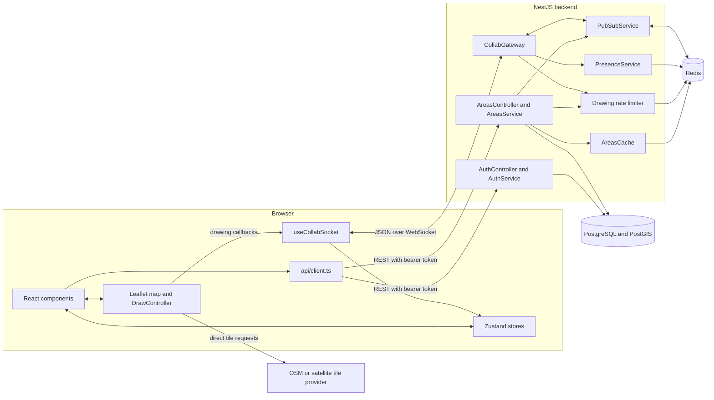
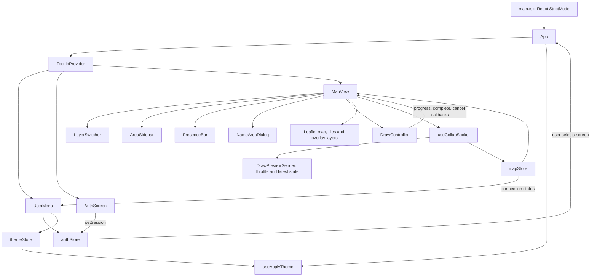

# Architecture

Snapland is a React/Leaflet map backed by a NestJS REST API and WebSocket gateway.
PostgreSQL/PostGIS stores users, sessions, polygons, history, and audit records.
Redis supplies bounds caching, drawing rate limits, presence, and broadcast fan-out.

The diagrams describe the implemented code. See [user flows](./user-flows.md) for
interaction behavior, [data flows](./data-flows.md) for message sequences, and
[roadmap](./roadmap.md) for the limits of the current implementation.

## System components

REST is the durable write path. WebSocket drawing messages are transient previews;
they do not create database rows. Redis channel `snapland:broadcast` distributes
messages to every backend instance, each of which sends them to its local clients,
except that drawing previews and cancellations skip their originating connection.
Each authenticated socket receives a server-generated UUID; Redis carries it in an
internal envelope alongside the public message. Gateways strip the envelope before
sending to clients. Other tabs for the same user still receive previews. Saved-area
and presence events reach everyone. There are no viewport rooms.
All backend instances must run this envelope-aware version before relying on sender
exclusion; legacy plain broadcasts remain accepted but cannot exclude a sender.

Presence uses four Redis structures under `presence:v2:*`: connection-to-user
membership, a sorted set of lease deadlines, user metadata, and connection counts.
A Lua script uses Redis time to prune expired memberships and atomically publishes
first-connection joins and final-connection leaves. Pongs renew 45-second leases;
15-second sweeps reconcile client lists. See the
[heartbeat flow](./data-flows.md#connection-leases-and-heartbeat).
The old `presence:users` hash is no longer read. Deploy this presence change with a
coordinated backend restart so old and new presence implementations do not overlap.
The script targets the current standalone Redis deployment; Redis Cluster would
need colocated keys. Pruning costs grow with expired connections, and snapshots
contain all online users, so large deployments should benchmark this path.

## Frontend component and state ownership

`AuthScreen` and `MapView` are mutually exclusive, selected by `authStore.user`.
`UserMenu` is always mounted: signed-out users can still choose a theme.

| Component or module | Responsibility |
|---|---|
| [MapView](../apps/frontend/src/map/MapView.tsx) | Owns the Leaflet instance, active basemap, drawing state, draft awaiting a name, area estimate, and panel visibility. Uses `BoundsAreaLoader` to fetch bounds on mount, `moveend`, and socket-ready transitions; renders saved polygons and remote polylines. Contains `NameAreaDialog` (also handles a stale-version conflict: reload-latest-or-discard) and a separate delete-confirmation dialog; sends `area:editing:start`/`stop` around an edit session. |
| [DrawController](../apps/frontend/src/map/DrawController.ts) | Owns draft vertices, draggable markers, midpoint insertion handles, preview geometry and keyboard listeners. Calls React callbacks; has no HTTP or WebSocket dependency. |
| [LayerSwitcher](../apps/frontend/src/map/LayerSwitcher.tsx) / [baseLayers](../apps/frontend/src/map/baseLayers.ts) | Select street/satellite; create OSM and configured satellite layers, with Esri fallback. |
| [AreaSidebar](../apps/frontend/src/components/AreaSidebar.tsx) | Lists area names and sizes, triggers edit/delete requests up to `MapView` (which owns the delete-confirmation dialog), shows an "Editing: {name}" badge when another user has that area open via `editingAreas`, owns left/right docking preference. |
| [PresenceBar](../apps/frontend/src/components/PresenceBar.tsx) | Renders the current presence list. |
| [UserMenu](../apps/frontend/src/components/UserMenu.tsx) | Avatar/status, full-width theme options, and logout; coordinates tooltip visibility with dropdown focus. |
| [api/client](../apps/frontend/src/api/client.ts) | Typed fetch wrapper; adds access token and retries once after HTTP 401 through the shared session-refresh coordinator. Exposes area CRUD and history methods. |
| [useCollabSocket](../apps/frontend/src/ws/useCollabSocket.ts) | Connects using the access token, dispatches events, reconnects, and waits for server presence initialization before flushing outbound state. |
| [DrawPreviewSender](../apps/frontend/src/ws/DrawPreviewSender.ts) | Coalesces previews to one per 100ms, immediately flushes drag-end positions, cancels pending sends, and keeps only the latest offline preview/cancellation. |
| [Shared types](../packages/shared/src/index.ts) | Compile-time models, DTO interfaces, geometry types, and WebSocket unions used by both apps. Backend REST DTO classes perform runtime validation separately. |

### State and persistence

| State | Owner | Persistence |
|---|---|---|
| User, access token, refresh token | `authStore` | `localStorage`: `snapland.session` |
| Areas, presence, remote drawings, connection status | `mapStore` | In memory; updated through REST bounds responses and WebSocket messages |
| Theme mode and resolved theme | `themeStore` | Mode in `snapland.theme`; auto uses local time, light from 06:00 until 19:00 |
| Areas panel open/closed | `MapView` | `snapland.areaSidebar.open` |
| Areas panel left/right | `AreaSidebar` | `snapland.areaSidebar.side` |
| Draft points, insertion handles | `DrawController` | In memory; removed on finish/cancel/destroy |
| Pending name, basemap selection | `MapView` | In memory; reset on remount |

`useApplyTheme` updates the root `.dark` class and `data-theme` attribute and checks
auto mode every minute. Storage access is guarded so unavailable storage does not
prevent using the UI.

### Map and overlay rendering

The map container keeps a stable `className`: Leaflet adds its own classes, which a
React class replacement would erase. `data-base-layer` selects the street or
satellite dark-mode filter. Switching adds the selected tile layer and removes the
previous one; it does not recreate the map or change overlay coordinates.

The custom toolbar replaces Leaflet's zoom control. UI stacking is:

| UI layer | z-index / behavior |
|---|---|
| Toolbar and area sidebar | `1000` |
| Fixed avatar control | `1600` |
| Dropdowns and dialogs | `2000`, portal content |
| Shared Radix tooltips | `2100`, portal content, default 12px offset |

The portal lets tooltips escape both ancestor stacking contexts and the sidebar's
`overflow-hidden`. Leaflet's polygon labels use Leaflet tooltips, not the shared
Radix wrapper. The avatar menu also has a 12px offset; opening or dismissing it
suppresses its status tooltip during focus restoration.

## Backend modules

| Module | Main components and dependencies |
|---|---|
| `AuthModule` | `AuthController` → `AuthService` → `AuthRepository`, `TokenService`, `AuditService`; Passport JWT strategy and guard |
| `AreasModule` | `AreasController` → `AreasService` → `AreasRepository`, `AreasCache`, `AuditService`, `PubSubService`, metrics; imports `WebsocketModule` |
| `WebsocketModule` | `CollabGateway`, `PresenceService`, `PubSubService`; imports auth for access-token verification |
| `DatabaseModule` | Global `pg.Pool` provider |
| `RedisModule` | Global command/publish client and separate subscription client |
| `AuditModule` / `MetricsModule` | Global audit writer and Prometheus registry |
| `HealthModule` | Liveness, database/Redis readiness, metrics endpoints |
| `AppModule` | Global validated configuration, request-timeout and HTTP metrics middleware |

Source: [AppModule](../apps/backend/src/app.module.ts). REST uses a global
`ValidationPipe`; the raw WebSocket handler parses its own `{type,payload}` envelope
and validates it with strict Zod schemas in `websocket/client-message.schema.ts`.
Invalid messages are rejected before metrics/Redis. The gateway catches async
message, setup, and cleanup failures, and isolates socket send failures. See
[WebSocket validation and errors](./api-reference.md#runtime-validation).

## Technical decisions

| Area | Implemented choice |
|---|---|
| Spatial storage | `geography(Polygon,4326)` with GiST index; PostGIS computes saved area in km² |
| Live area estimate | Turf `area()` on the client, recalculated when points change |
| Database access | Parameterized SQL through `pg.Pool`, migrations through `node-pg-migrate` |
| Authentication | Separate access/refresh JWT secrets, database-backed rotated refresh sessions |
| Conflicts | Integer version checked by update/delete SQL; stale writes return 409, with no merge |
| Drawing | Custom Leaflet controller; draggable vertices and projected edge midpoints; Finish or Enter to complete |
| UI | React, Zustand, Tailwind, in-repo shadcn/Radix components |
| Monorepo | pnpm workspaces and Turborepo; shared package built before dependent build/lint/test tasks |

Bounds queries return at most 1,000 rows. Redis caches them for 30 seconds using
bounds rounded to 0.01 degrees and a global version key for invalidation. These
choices reduce repeated reads but do not establish a measured throughput target;
see [database](./database.md) and [roadmap](./roadmap.md).
