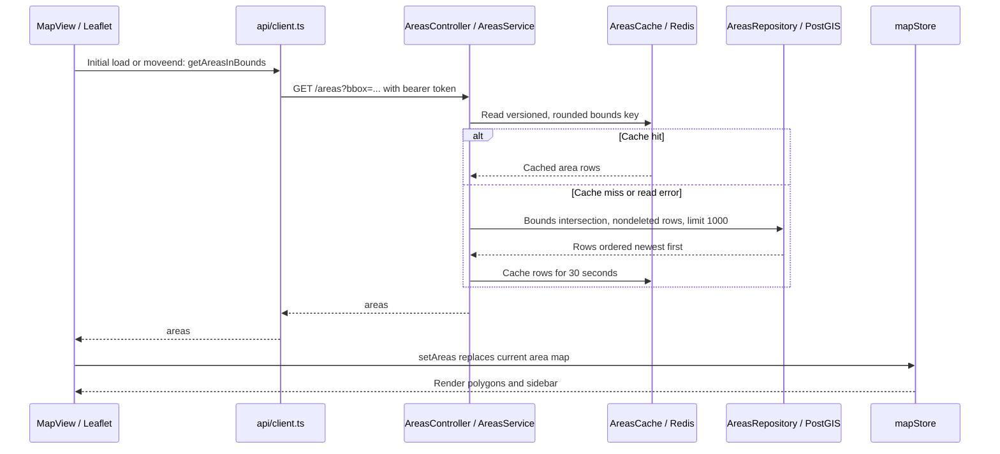
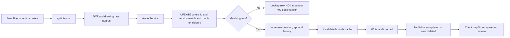
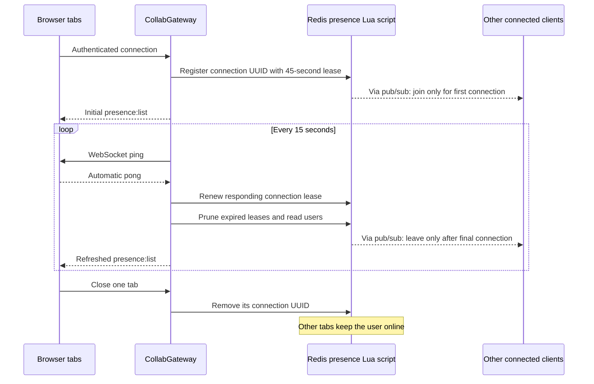
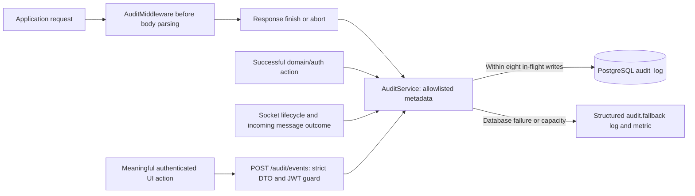

# Data flows

These sequences name the components in the current implementation. The
[API reference](./api-reference.md) defines the wire format; the
[architecture](./architecture.md) describes ownership and dependencies.

## Authentication and refresh

```mermaid
sequenceDiagram
  actor User
  participant Screen as AuthScreen
  participant API as api/client.ts
  participant Auth as AuthService
  participant DB as AuthRepository / PostgreSQL
  participant Store as authStore
  User->>Screen: Log in or register
  Screen->>API: login or register
  API->>Auth: POST /auth/login or /auth/register
  Auth->>DB: Verify/create user; store hashed refresh session
  Auth-->>API: user, accessToken, refreshToken, expiresIn
  API-->>Screen: Session response
  Screen->>Store: setSession; persist in localStorage
  Note over Screen,Store: App mounts MapView; socket connects with access token
  API->>Auth: Later authenticated REST request
  Auth-->>API: 401 if access token is invalid
  API->>Auth: POST /auth/refresh with refresh token
  Auth->>DB: Verify session; revoke old session; create new session
  Auth-->>API: New token pair and user
  API->>Store: Replace stored session
  API->>Auth: Retry original request once
```

The final REST request in the diagram may target any protected controller. If
refresh fails (including a network failure), the matching local session is cleared
and the app returns to login. [refreshSession](../apps/frontend/src/api/refreshSession.ts)
shares one refresh promise across HTTP and socket callers in the same tab. A late
rejection of an older access token reuses the already renewed token. A completed
refresh cannot restore a session after logout or replace a newer login.
The hook reconnects when the access token changes. Coordination across different
browser tabs and backend refresh-session concurrency remain separate work. Two
tabs may attempt to rotate the same refresh token concurrently, causing one refresh
to fail and clear that tab's session. Cross-tab coordination is a deferred, optional
reliability improvement, not an explicit assignment requirement. Logout requests session revocation and clears the
local session even if the network request fails.

Sources: [auth service](../apps/backend/src/auth/auth.service.ts),
[REST client](../apps/frontend/src/api/client.ts),
[auth store](../apps/frontend/src/state/authStore.ts).

## Viewport reads and cache



Bounds keys round each coordinate to 0.01 degrees; the SQL uses the original bounds.
Nearby requests can therefore share a cached result without exact edge agreement.
Writes increment `areas:cache:version`; old entries expire naturally. Cache failures
are logged and reads fall back to Postgres. Bounds requests are not cancelled, but the frontend applies only the latest
request and ignores responses after map teardown. Live area mutations received
during that request are applied over its result, including deletion tombstones.

## Draft edits and durable creation

```mermaid
sequenceDiagram
  actor User
  participant Draw as DrawController
  participant View as MapView
  participant Socket as useCollabSocket
  participant GW as CollabGateway
  participant Redis as Redis / PubSubService
  participant Areas as AreasController / AreasService
  participant DB as AreasRepository / PostGIS
  participant Clients as All connected clients
  User->>Draw: Add, drag, or insert a vertex
  Draw->>Draw: Update geometry, midpoints and Turf estimate
  Draw->>View: onProgress(points, areaKm2)
  View->>Socket: sendDrawProgress(points, immediate on drag end)
  Socket->>Socket: Coalesce regular previews to one per 100ms
  Socket->>GW: draw:progress
  GW->>GW: Parse JSON and validate strict message schema
  GW->>Redis: Check preview limit; publish current allowed preview with origin connection ID
  Redis-->>GW: snapland:broadcast on every instance
  GW-->>Clients: draw:progress, excluding originating connection
  Note over Clients: useCollabSocket updates remoteDraws; MapView draws polylines
  User->>Draw: Finish or Enter
  Draw->>View: onComplete(points, areaKm2)
  View->>Socket: sendDrawCancel; show name dialog
  Socket->>GW: draw:cancel
  GW->>Redis: Publish cancellation with origin connection ID
  Redis-->>Clients: Via gateways: clear preview except on originating connection
  User->>View: Enter name and Save
  View->>Areas: api/client.ts POST /areas with closed ring
  Areas->>Areas: JWT guard, drawing rate guard, DTO and geometry validation
  Areas->>DB: Insert area; compute ST_Area / 1e6
  Areas->>DB: Insert history snapshot
  Areas->>Redis: Invalidate bounds cache version
  Areas->>DB: AuditService records area.create
  Areas->>Redis: Publish area:created
  Redis-->>Clients: Via gateways: upsert saved area in mapStore
  Areas-->>View: 201 with saved area
```

`MapView` awaits the create response but does not upsert that response into its
store. The `area:created` event normally supplies the saved area, or a subsequent
bounds request reloads it. Event delivery and HTTP response order are not guaranteed.

The area mutation and its history row commit together in one Postgres transaction
(`AreasRepository.createWithHistory`/`updateWithHistory`/`removeWithHistory`; see
[database.md](./database.md#write-ordering-and-history-access)). Cache invalidation,
audit, and publication remain separate, non-transactional steps that run only after
that commit — no outbox guarantees they all complete. Audit errors are caught and
logged; audit calls are awaited. Preview coordinates are `[lng, lat]`; Leaflet uses
`LatLng` objects internally. The draft is open until `MapView` appends its first
point for REST submission.

## Update and delete paths



Delete sets `deleted_at`; it does not physically remove the row. Both paths share
the write/publication limitations described above. History is retained in the
database and remains readable through the history endpoint after soft deletion.
A nonexistent area with no retained history still returns 404.

## Conflict handling on a stale write

The version check above (`UPDATE ... WHERE version = $expected`) is the actual
safety net against a lost update — it's never bypassed. What happens around a
`409` is a separate, frontend-only concern:

- On `409` from `PUT /areas/:id`, [MapView.confirmArea](../apps/frontend/src/map/MapView.tsx)
  fetches the area's current state via `GET /areas/:id` and shows the user an
  explicit choice — reload the latest version into the editor (discarding the
  local draft) or discard their own edit. There is no silent overwrite and no
  automatic field/geometry merge; the reject is surfaced as an actionable state
  instead of a dead-end error string.
- On `409`/`404` from `DELETE /areas/:id`, the delete-confirmation dialog shows
  the specific reason (changed or already deleted) instead of failing silently.

### Area-editing presence

A lighter-weight, best-effort signal reduces how often that conflict happens in
the first place: when a user opens a saved area in the editor, the client sends
`area:editing:start { areaId }`; the gateway records it in
[AreaEditingService](../apps/backend/src/websocket/area-editing.service.ts) (a
single Redis hash, `areaId -> {user, connectionId, expiresAt}`) and broadcasts a
full `area:editing:list` snapshot so every connected client can show "editing by
{name}" next to that area. `area:editing:stop`, a lease renewal piggybacked on
the existing pong heartbeat, and a 30-second app-level expiry (not a Redis TTL —
checked lazily in `list()`) keep it current without a dedicated sweep job; a
crashed tab's lease is cleared on `handleDisconnect` or ages out within 30s.

This is advisory, not a lock: it never blocks a write, two users can still open
the same area at once, and a late-joining client only learns about an in-progress
edit on the next heartbeat tick (every 15s) rather than instantly. The version
check remains the only thing that actually prevents data loss.

## Reconnection and state recovery

[useCollabSocket](../apps/frontend/src/ws/useCollabSocket.ts) opens `/ws?token=...`.
The gateway verifies the token and registers a unique connection with
[PresenceService](../apps/backend/src/websocket/presence.service.ts). Redis publishes
`presence:join` only for the first connection of a user. The gateway then sends an
initial `presence:list`. Disconnect removes only that connection; Redis publishes
`presence:leave` when the final connection disappears, and clients clear that user's draft.

On socket close, the hook marks the status offline and retries with delays of
1, 2, 4, 8, then at most 15 seconds. Retry attempts set the status to reconnecting.
Receiving `presence:list` confirms server setup, marks the connection open, resets
the retry count, and flushes the latest pending preview or cancellation. The raw
transport open event alone does not flush messages because server authentication
and presence setup may still be running.

[DrawPreviewSender](../apps/frontend/src/ws/DrawPreviewSender.ts) retains one latest
pending state instead of an unbounded message queue. Normal updates are sent at
most every 100ms; drag end flushes immediately. Cancellation clears the preview
timer and replaces pending points with `draw:cancel`. Unmount/token changes clear
the buffer and timer. This buffer is not durable storage or inbound event recovery.
Preview requests have their own default 20/second per-user budget; REST writes
retain 50/minute independently.

Visible areas are automatically refetched when the socket becomes ready again.
There is no incoming event replay. A socket closed with authentication code **4001** uses the
same refresh coordinator as HTTP 401 responses and reconnects with the renewed
token. Ordinary network closes retain exponential backoff. If a refreshed token
is rejected again before `presence:list`, recovery clears the matching session
instead of entering a refresh loop. Successful readiness resets that guard. `viewport:update` is a reserved
no-op and is not sent by the current frontend. Broadcasts are global; the area map
may contain out-of-viewport events until the next bounds response replaces it.

### Outbound backpressure

[CollabGateway.send](../apps/backend/src/websocket/collab.gateway.ts) checks each
client's `bufferedAmount` (bytes `ws` has queued but not yet flushed to the socket)
before every send, independent of fan-out or how many other clients are connected.
Past `WS_BACKPRESSURE_SOFT_BYTES` (default 64KB), droppable preview types
(`draw:progress`, `draw:cancel`) are skipped for that client — safe because both
are latest-wins and a fresher update follows shortly. Past
`WS_BACKPRESSURE_HARD_BYTES` (default 1MB), the connection is torn down like a
failed heartbeat ping, regardless of message type; the client's own reconnect loop
re-establishes the socket and refetches presence. Durable messages (`area:*`,
`presence:*`, `error`) are never silently dropped — only shed via that hard
disconnect. This protects server memory from one slow client under high broadcast
volume; it does not queue or replay messages across the gap.


### Refreshing areas after reconnection

```mermaid
sequenceDiagram
  participant WS as useCollabSocket
  participant Store as mapStore
  participant Loader as BoundsAreaLoader
  participant API as Areas REST API
  WS->>Store: presence:list changes status to open
  Store->>Loader: Ready transition
  Loader->>API: GET areas using current map bounds
  WS->>Store: Any live area changes during request
  Store->>Loader: Record changed area or deletion
  API-->>Loader: Saved areas snapshot
  Loader->>Loader: Ignore obsolete requests; overlay live changes
  Loader->>Store: Replace displayed saved areas
  Note over Loader,Store: Drawing controller and local edit state stay intact
```

[BoundsAreaLoader](../apps/frontend/src/map/BoundsAreaLoader.ts) also handles initial
map loading and `moveend`. Each transition into `open` refreshes once, including
initial socket readiness and connections replaced after token changes. Repeated
heartbeat lists do not trigger extra requests. An error keeps the previous areas
visible and is logged; the next map move or ready transition retries. There is no
background retry timer or user-facing refresh error in this change.

### Connection leases and heartbeat



Ping/pong uses WebSocket control frames, so browsers respond without application
messages. A socket missing the next heartbeat is terminated (normally within
15–30 seconds of becoming unresponsive). Lease deadlines use Redis time; sweeps
run on every backend, including instances with no local sockets. A crashed
instance's connections disappear within approximately 45–60 seconds of their last
renewal while Redis and at least one backend are available. If every backend is
down, the next presence operation after restart prunes expired leases.

Registration, renewal, removal, pruning, connection counts and join/leave
publication run in one Lua script. This orders concurrent operations across
instances and prevents one tab's disconnect from removing another. Every successful
sweep also sends local clients a presence snapshot to repair missed pub/sub events.
Transport checks continue even if a Redis sweep is pending; async errors are logged.
Presence is eventually consistent during outages. Drafts remain keyed by user ID,
so simultaneous drawings in multiple tabs are still not independent drafts.

## Validation and infrastructure failures

Incoming messages pass through JSON parsing and strict Zod validation before the
rate limiter or broadcast path. Invalid JSON/payloads return coded errors without
closing the socket. A limiter or publish rejection produces `internal_error`,
with details logged only on the server; subsequent messages can still be handled.
A setup failure instead closes with 1011 and attempts cleanup. Disconnect cleanup
and send failures are also contained, but there is no retry/outbox guarantee.
Messages above 64 KiB are rejected by the WebSocket transport with close code 1009.
See [API error responses](./api-reference.md#error-responses-and-connection-behavior).

## User-action auditing



The actor comes from server authentication. Browser analytics are marked
client-reported, and credentials/raw payloads are omitted. Full coverage, queries,
and delivery limits are documented in [auditing.md](./auditing.md).
