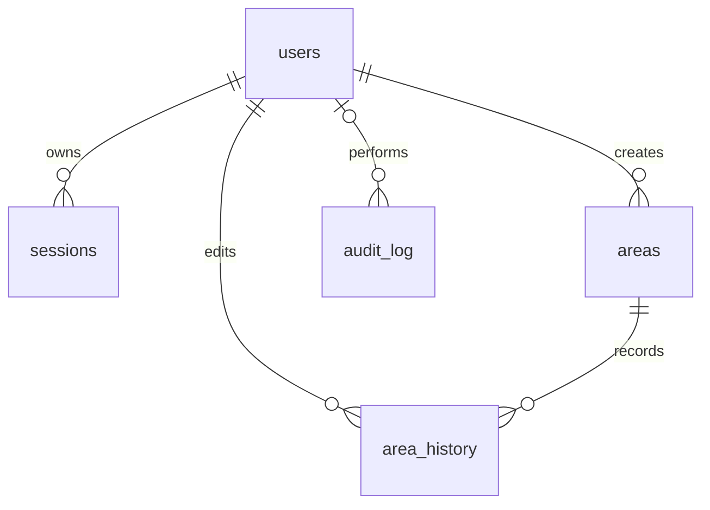

# Database

PostgreSQL + [PostGIS](https://postgis.net/). Schema lives in
`apps/backend/migrations/` ([node-pg-migrate](https://github.com/salsita/node-pg-migrate)),
applied via `pnpm --filter @snapland/backend migrate:up` (or automatically by
`make up` / `make dev` / `make migrate` — see [deployment.md](./deployment.md)).

## Extensions

| Extension | Used for |
|---|---|
| `postgis` | `geography(Polygon,4326)` columns, `ST_Area`, `ST_MakeEnvelope`, `ST_AsGeoJSON` |
| `pgcrypto` | `gen_random_uuid()` for all primary keys |
| `citext` | Case-insensitive `users.email` uniqueness |

## Relationships



`sessions.user_id` and `area_history.area_id` use cascading foreign keys;
`audit_log.user_id` becomes null when the user is deleted. `entity_type` and
`entity_id` in the audit log identify subjects but are not an entity foreign key.
Area deletion in the application is a soft delete, so it does not invoke cascades.

## Tables

### `users`

| Column | Type | Notes |
|---|---|---|
| `id` | uuid PK | `gen_random_uuid()` |
| `email` | citext, unique | |
| `password_hash` | text | bcrypt |
| `name` | text | |
| `created_at` | timestamptz | |

### `sessions`

Refresh-token sessions (see [security.md](./security.md)).

| Column | Type | Notes |
|---|---|---|
| `id` | uuid PK | Generated **application-side** and embedded in the refresh JWT before the row is inserted, so the JWT's session id always matches the row |
| `user_id` | uuid FK → `users`, `ON DELETE CASCADE` | indexed |
| `refresh_token_hash` | text | bcrypt hash of the refresh JWT — never store the raw token |
| `expires_at` | timestamptz | |
| `revoked_at` | timestamptz, nullable | set on logout or token rotation |
| `created_at` | timestamptz | |

### `areas`

| Column | Type | Notes |
|---|---|---|
| `id` | uuid PK | |
| `name` | text | |
| `geom` | `geography(Polygon,4326)` | **GiST-indexed** |
| `size_km2` | double precision | computed via `ST_Area(geom) / 1e6` at write time |
| `version` | integer, default `1` | optimistic-concurrency guard — see [security.md](./security.md) |
| `created_by` | uuid FK → `users` | |
| `created_at` / `updated_at` | timestamptz | |
| `deleted_at` | timestamptz, nullable, **indexed** | soft delete |

Also indexed: `created_at` (bounds-query result ordering).

### `area_history`

Append-only version log for every create/update/delete on `areas` (satisfies the
assignment's "area versioning and edit history" requirement). One row per version,
snapshotting its geometry, name, size, and version with the editor and change type.
The area write and its history row commit together in one transaction — see
[Write ordering and history access](#write-ordering-and-history-access) below.

| Column | Type | Notes |
|---|---|---|
| `id` | uuid PK | |
| `area_id` | uuid FK → `areas`, `ON DELETE CASCADE`, indexed | |
| `geom`, `name`, `size_km2`, `version` | — | snapshot at that version |
| `edited_by` | uuid FK → `users` | |
| `edited_at` | timestamptz | |
| `change_type` | text, `CHECK IN ('created','updated','deleted')` | |

### `audit_log`

Application-written trail for HTTP outcomes, domain actions, authentication and
refresh, socket lifecycle/messages, and authenticated UI actions. See
[audit coverage](./auditing.md) for metadata, exclusions, and fallback behavior.

| Column | Type | Notes |
|---|---|---|
| `id` | uuid PK | |
| `user_id` | uuid FK → `users`, `ON DELETE SET NULL`, indexed | |
| `action` | text | e.g. `"area.create"`, `"user.login"` |
| `entity_type` / `entity_id` | text / uuid | |
| `metadata` | jsonb, default `{}` | action-specific extra detail |
| `created_at` | timestamptz, indexed | |

## Indexing strategy

- **`areas.geom` (GiST)**: bounds queries (`GET /areas?bbox=...`) filter with
  `geom && ST_MakeEnvelope(...)::geography`, which the planner can satisfy with this
  index. Map queries return at most `AREAS_QUERY_LIMIT` nondeleted areas, newest first
  (default 1,000). The separate `/areas/search` endpoint uses immutable UUID
  cursor ordering, case-insensitive literal substring matching, and a bounded
  page size (default 100, maximum 200). Each response includes the matching total.
- **`areas.deleted_at`**: every query filters `WHERE deleted_at IS NULL`; indexing it
  provides a filtering option to the query planner; this is a full-column index,
  not a partial index on live rows.
- **`areas.created_at`**: bounds-query results are ordered by this. The planner
  sometimes uses *this* index instead of the GiST one for the bounds query — see
  below.
- **FK columns** (`sessions.user_id`, `area_history.area_id`, `audit_log.user_id`):
  standard indexing for join/lookup performance and cascade-delete efficiency.

### Benchmark results (10,000 rows)

Measured with `apps/backend/scripts/bench-seed.js` (10,000 synthetic polygons
scattered across a Tel Aviv-sized bbox), `bench-query.js` (query run directly
against Postgres, bypassing the app and `AreasCache`), and `bench-http.js`
(concurrent load against a running server, bypassing nothing). Single
developer machine, not a production-sized instance — treat as relative, not
absolute, numbers. Run `pnpm --filter @snapland/backend bench:seed` /
`bench:query` / `bench:http` / `bench:cleanup` to reproduce.

**Which index the planner picks depends on selectivity**, confirmed via
`EXPLAIN (ANALYZE, BUFFERS)`:
- A bbox matching ~33% of rows (3,286 of 10,018) used `areas_created_at_index`
  — cheaper to scan in `created_at` order and stop at `LIMIT 1000` than to
  bitmap-scan ~3,300 geom matches first. DB-only query time: p50 41.7ms, p95
  43.9ms, p99 54.9ms.
- A bbox matching ~1.6% of rows (160 of 10,018) used `areas_geom_index` (GiST,
  via a bitmap heap scan) — filtering by geometry first is cheaper once the
  match set is small. DB-only query time: p50 9.5ms, p95 11.1ms, p99 16.4ms.

Both are legitimate planner choices for this `ORDER BY created_at LIMIT 1000`
shape; the GiST index is doing its job once a query is actually selective,
which is the realistic case for a map viewport as the table grows well past
10,000 rows.

**HTTP-level load test** (20 concurrent workers, 8s, same 10,000-row dataset,
through the real `GET /areas` endpoint including `AreasCache`) showed payload
size dominates over the index choice:

| Result set | Response size | Throughput | p50 | p95 | p99 |
|---|---|---|---|---|---|
| Wide bbox (1,000 rows, full GeoJSON each) | ~436KB | ~230 req/s | ~82ms | ~100ms | ~250ms |
| Tight bbox (~160 rows) | ~70KB | ~1,150 req/s | ~16ms | ~22ms | ~44ms |

`AreasCache` (30s TTL, rounded bbox key) made little difference at this
concurrency — the client and server were on the same machine competing for
CPU to serialize/parse large JSON payloads, which likely dominates over
Redis's few-millisecond lookup either way. That's a measurement limitation
(single-machine, single-process load generator), not evidence the cache
doesn't help; it should be re-measured from a separate load-generation host
for a clean server-only number.

The practical takeaway: **the current 1,000-row, full-geometry, no-pagination
response is the actual bottleneck**, not the spatial index — it reinforces
the map bounds-query payload limitation (see [roadmap.md](./roadmap.md)) with
real numbers instead of just an assumption. A production deployment expecting
routinely-wide viewports at 10,000+ polygons per region should prioritize
pagination or a lighter list representation (e.g. simplified/clustered
geometry at low zoom) over further index tuning.

## Migrations

Add a new migration with:

```bash
pnpm --filter @snapland/backend migrate:create <name>
```

Migrations are plain JS files using `node-pg-migrate`'s `pgm` builder (see
`apps/backend/migrations/1700000000000_init.js` for the existing schema). Run with
`pnpm --filter @snapland/backend migrate:up` / `migrate:down`, or via `make migrate`
against the containerized Postgres.

## Write ordering and history access

The area mutation and its matching `area_history` row are the only two writes with
an atomicity guarantee: `AreasRepository.createWithHistory`/`updateWithHistory`/
`removeWithHistory` run both on one connection inside a single transaction
(`BEGIN` … `COMMIT`/`ROLLBACK`, see `database/transaction.util.ts`), so a history
insert failure rolls back the area write too — a create doesn't leave an orphaned
area row, an update doesn't change name/geometry/version, and a failed delete
leaves the area visible. The optimistic-concurrency version check
(`WHERE version = $expected`) runs inside the same transaction; a mismatch simply
commits an empty transaction (nothing was written) and the service layer turns
that into `404`/`409`.

Everything else — cache invalidation, the audit write, WebSocket publication, and
the draw-actions metric — runs in `AreasService` only *after* that transaction has
committed, sequentially and non-transactionally. Audit logging in particular is
deliberately best-effort (`AuditService.record` catches and logs its own
failures rather than propagating them): an audit-write failure must not roll back,
or even fail, the user's actual area change. This means a crash between commit and
one of those later steps can still leave the cache stale, an event unpublished, or
an audit entry missing — Postgres transactions make the area+history pair atomic,
they don't extend to Redis cache invalidation or pub/sub delivery. Making that
delivery reliable (e.g. an outbox table polled by a publisher) is a separate,
larger change — see [roadmap.md](./roadmap.md).

History/audit are append-only by application convention, not enforced by database
permissions or triggers. The history endpoint returns retained snapshots after
soft deletion too; unknown IDs without an area or history return 404. It joins
users to provide `editorName` alongside the stable `editedBy` identifier.
