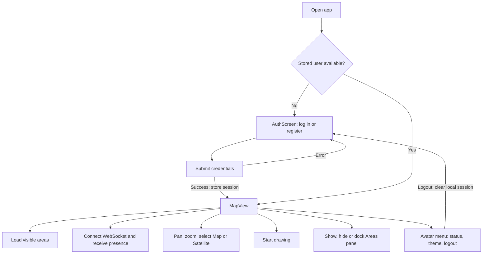
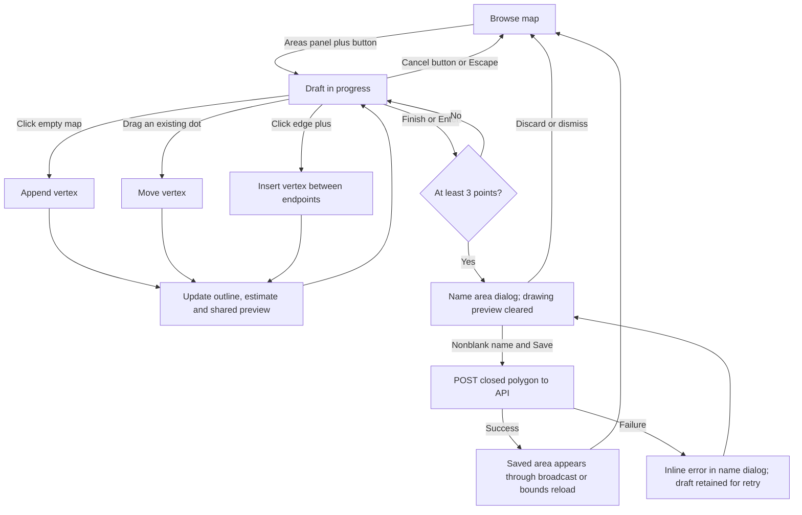

# User flows

This page describes the current browser UI. For the responsible components see
[architecture](./architecture.md); for network sequences see [data flows](./data-flows.md).

## Sign in and explore

A stored user selects the map immediately; this is not an up-front server session
check. An HTTP 401 triggers the REST client's refresh flow. The theme menu is also
available on the sign-in screen.

Map starts centered on Tel Aviv at zoom 14. Map/Satellite swaps the basemap while
preserving the viewport and overlays. The Areas button toggles the list; its arrow
button moves it between left and right. Visibility and docking survive a reload.

## Draw, adjust, and save

| Action | Current behavior |
|---|---|
| Click empty map | Appends a point immediately, with no double-click detection delay. |
| Drag any existing dot | Changes its coordinates, outline, area estimate, and shared preview. Clicking the first dot does not finish. |
| Click translucent `+` | Inserts a draggable point at that edge's projected midpoint. Handles include the closing edge for drafts with at least three points. |
| Finish button | Enabled after three points; validates the ring before opening the name dialog. Invalid shapes stay editable with an inline explanation. |
| Double-click map or a handle | Does not finish. Repeated clicks with a click count greater than one are ignored. Map double-click zoom stays disabled while drawing and is restored afterward if previously enabled. |
| Enter | Finishes when at least three points exist. |
| Escape or Cancel button | Clears the draft and sends `draw:cancel`. |
| Save in name dialog | Requires a nonblank name. Appends the first point to close the GeoJSON ring and submits it by REST. |

While drawing, a separate Drawing tips card sits below the toolbar. On desktop it
sits alongside the Areas panel, respecting left/right docking; on mobile it sits
above the panel with the tips in two columns. It contains the live size, Finish (✓), and Cancel (×) controls and disappears when drawing ends.

Finishing a drawing also sends `draw:cancel` to clear the transient shared outline;
it does not save the area until the name is submitted. The backend validates the
polygon and supplies the authoritative size. The browser and API share validation for duplicate vertices, zero-area rings,
crossing/touching/overlapping edges, and coordinate limits. The editor prevents
adding more than 499 vertices. A failed save shows an inline error in the name
dialog and keeps the draft open — the user can retry without redrawing. When
editing a saved area, a stale-version (409) conflict instead fetches the
area's current state and swaps the dialog's Save button for "Reload latest
version" (discarding the local draft and re-seeding the editor from the fresh
version) alongside Discard; a 404 means the area was deleted by someone else.

## View and delete saved areas

Saved polygons are green, with a Leaflet tooltip showing their name and size.
The sidebar searches all saved areas independently of map bounds, loading 100-row
cursor pages as you scroll. A 200ms debounce limits search requests; virtualization
mounts only visible rows plus a buffer. The badge shows total matches. Each row has Focus and a `⋯` actions
menu (Edit, History, Delete). Delete opens a confirmation dialog ("Delete area? ... This
cannot be undone"); confirming sends the area's current version to
`DELETE /areas/:id?version=N`. A successful broadcast removes it from clients.
A stale version (409, "changed by someone else") or an already-deleted area
(404) is shown inline in the dialog instead of a silent console log; the 404
case also removes the stale area from the sidebar locally.

Double-clicking a saved polygon also starts editing. Drag inside the draft to move
the whole shape; Cancel discards the move and Finish/Save persists it.

Dragging and midpoint insertion apply to both a new draft and an existing
area opened via Edit — Edit pre-seeds the draw session with the saved geometry
and focuses the map on it, and the name dialog's Save then calls the update
endpoint with the area's version instead of creating a new one (see conflict
handling above). The Edit action is disabled while another draft is already
open. A badge next to an area's size in the sidebar ("Editing: {name}") shows
when another user currently has that area open for editing — advisory only,
not a lock; see [data flows](./data-flows.md#area-editing-presence). The History action opens saved versions newest first with the editor, timestamp,
name, size, vertex count and an expandable shape preview. History is read-only;
there is no restore action. An open history viewer refreshes after live changes,
and history remains available through the API after soft deletion.

## Collaboration and preferences

The avatar ring indicates connection status, and presence avatars show the shared
online-user list. Closing one tab keeps the user online in other tabs. Heartbeats
and expiring connection leases remove abandoned sessions; the list is periodically
refreshed after missed notifications. Preview messages reach every connection except the originating socket
(including other tabs for the same user);
the client renders received previews as orange dashed polylines. Local editing stays
immediate; regular shared previews send at most ten times per second, with an
immediate final update at drag end. Reconnect retains only the latest preview or
cancellation in memory. Saved-area writes require REST and are not queued for
offline saving. After reconnection, the visible saved areas refresh automatically;
your current drawing or edit stays in progress. See [reconnection details](./data-flows.md#reconnection-and-state-recovery).

The avatar menu offers Auto, Light, and Dark in equal-width options. Auto follows
local clock time: light from 06:00 until 19:00. Hover tooltips have a 12px gap and
appear above the panel. Opening or dismissing the avatar menu does not reopen its
status tooltip through restored focus.
